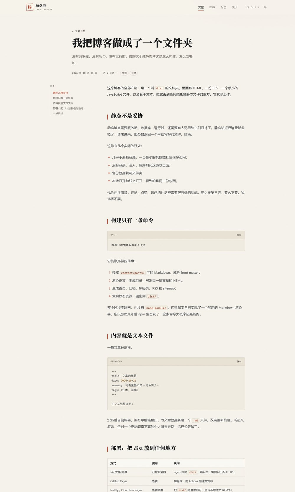
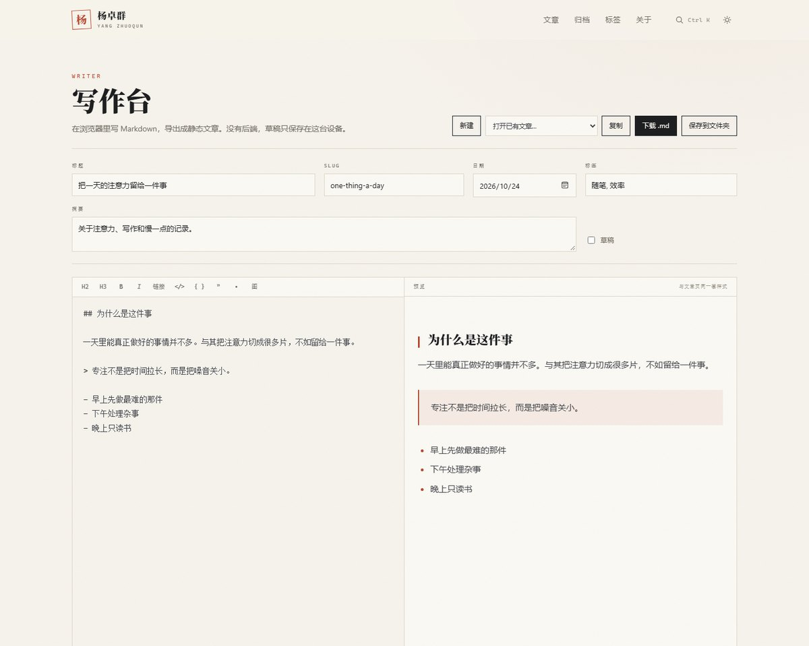
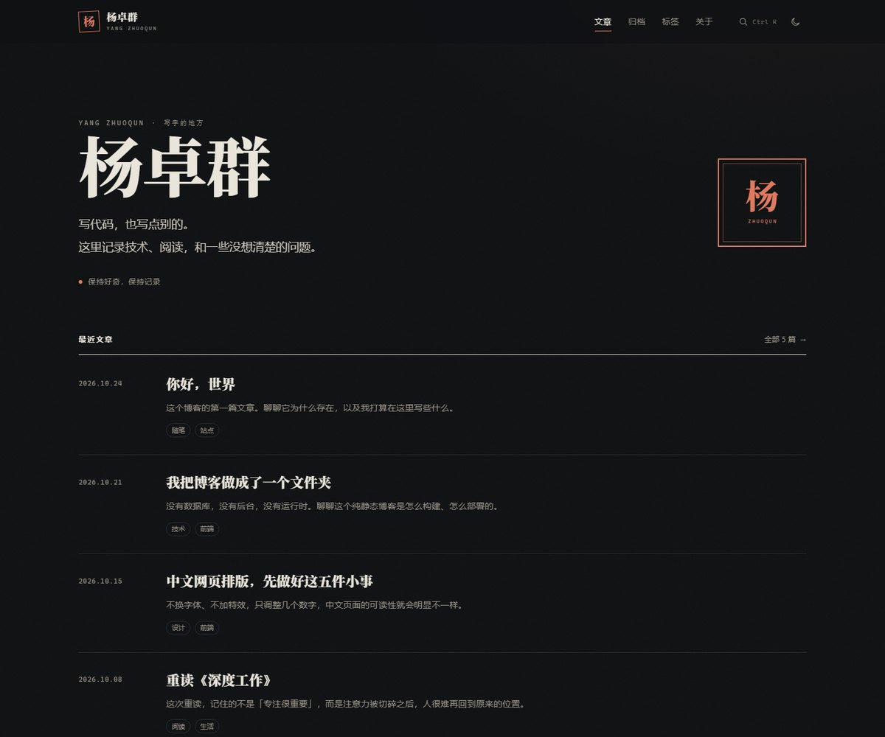

# 杨卓群 · 博客

一个纯静态的个人博客：Markdown 写作，一条命令构建，得到一个可以直接托管的 `dist/` 文件夹。

没有数据库、没有后台、没有 npm 依赖、没有第三方脚本。构建不联网，运行时也不需要 Node。

---

## 域名现在是什么状态

`blog.yangzhuoqun.is-a.dev` 在 is-a.dev 的注册还在：

- DNS 能解析，A 记录指向 `154.9.227.36`；
- 这台服务器的 nginx 在线，但根路径返回 **404**；
- **443 端口没有开**，所以 `https://` 目前连不上。

结论：**域名还能用**，只是后面没有站点、也没有证书。这个项目就是为它准备的。

---

## 先看效果

`dist/` 已经构建好了，两种预览方式任选：

```bash
# 需要 Node 18+
npm run dev
# http://127.0.0.1:4173
```

```bash
# 不需要 Node
python -m http.server 4173 --directory dist
```

## 预览






深色与手机宽度：




---

## 目录

```
content/posts/      文章，一篇一个 .md
content/pages/      关于页
src/assets/         样式、脚本、favicon
scripts/            构建 / 预览 / 新建文章
dist/               构建产物，可直接部署（已被 .gitignore 忽略）
deploy/             Nginx、VPS 上传脚本、is-a.dev 记录示例
.github/workflows/  GitHub Pages 自动部署
site.config.mjs     站点名、简介、邮箱、导航、标签 URL
```

---

## 写作

### 写作台（推荐）

构建后打开 `/write/`，或者点页脚的「写作台」。它是一个纯前端编辑器：

- 左边写 Markdown，右边实时预览，和文章页使用同一套渲染器；
- 自动保存草稿到浏览器本地（可一键清除），没有后端、不上传任何内容；
- 「下载 .md」得到 `slug.md`；Chromium 内核浏览器还可以「保存到文件夹」，直接写进 `content/posts/`；
- 「打开已有文章」可以载入 `content/posts/` 里已有的 Markdown 来改；
- 设置一次 GitHub token 后，点「发布上线」会把文章提交到仓库，GitHub Actions 自动构建、自动部署，约 1–2 分钟上线。token 只保存在本机浏览器里。

写完把 `.md` 放进 `content/posts/`，运行 `npm run build`，再把 `dist/` 部署上去。

### 命令行新建

```bash
node scripts/new-post.mjs "文章的标题" the-slug
```

`the-slug` 会出现在网址里，只能用小写字母、数字、连字符。

一篇文章长这样：

```md
---
title: 文章标题
date: 2026-10-24
summary: 列表里显示的一句话简介。
tags: [随笔, 技术]
---

正文从这里开始。
```

- `title`、`date` 必填；
- `summary` 不填会自动截取正文开头；
- `tags` 写中文，URL 映射在 `site.config.mjs` 的 `tagSlugs` 里；
- 草稿加 `draft: true`，用 `DRAFT=1 npm run build` 可以本地预览（Windows PowerShell 用 `$env:DRAFT=1; npm run build`）；
- 站名、简介、邮箱、社交链接也都在 `site.config.mjs`。

改完重新构建：

```bash
npm run build
```

构建会生成首页、文章页、归档、标签页、关于、404、RSS、sitemap、搜索索引。

---

## 部署

### 方案 A：继续用现在的服务器（域名不用改，推荐给国内读者）

现状是域名已经指向这台机器，只需要把 `dist/` 放上去、配好 nginx 和证书。

1. 把 `deploy/nginx/blog.conf` 传到服务器并启用：

   ```powershell
   scp deploy\nginx\blog.conf root@154.9.227.36:/tmp/blog.conf
   ssh root@154.9.227.36 "cp /tmp/blog.conf /etc/nginx/sites-available/blog.conf && ln -sf /etc/nginx/sites-available/blog.conf /etc/nginx/sites-enabled/blog.conf && nginx -t && systemctl reload nginx"
   ```

2. 在本机上传（在项目根目录运行）：

   ```powershell
   .\deploy\deploy-vps.ps1 -HostName 154.9.227.36 -User root
   ```

   默认传到 `/var/www/blog`。用 `-RemotePath` 可以改，`-ReloadNginx` 会在上传后自动 reload。

3. 配 HTTPS：

   ```bash
   sudo apt install certbot python3-certbot-nginx
   sudo certbot --nginx -d blog.yangzhuoqun.is-a.dev
   ```

4. is-a.dev 的记录**不用动**，继续是 A `154.9.227.36`。

### 方案 B：GitHub Pages（免费）

适合有 GitHub 账号、能接受国内访问可能不稳定的情况。

如果 GitHub 网页能打开，按下面手动做；如果网页也打不开，可以直接用
`deploy\deploy-github.cmd`（需要 token）自动建仓库、上传、开 Pages、提 is-a.dev PR。

1. 新建仓库（比如 `blog`），把本项目推上去，分支 `main`。
2. 仓库 **Settings → Pages → Build and deployment → Source** 选 **GitHub Actions**。
3. 推送后 `.github/workflows/deploy.yml` 会自动构建并发布。
4. **Settings → Pages → Custom domain** 填 `blog.yangzhuoqun.is-a.dev`（`dist/CNAME` 里已经写好）。
5. 把 `domains/blog.yangzhuoqun.json` 改成：

   ```json
   {
     "owner": {
       "username": "yangzhuoqun-666",
       "email": "yangzhuoqun_youxi@outlook.com"
     },
     "records": {
       "CNAME": "yangzhuoqun-666.github.io"
     }
   }
   ```

   然后向 [is-a-dev/register](https://github.com/is-a-dev/register) 提 PR。合并后 DNS 生效，GitHub 会自动签发 HTTPS。

> 用 `deploy\deploy-github.cmd` 自动部署时，为了让 PR 的预览链接可访问，会先不绑定自定义域名；PR 合并后再运行 `deploy\enable-custom-domain.cmd` 把域名加回去。

### 方案 C：Netlify（免费）

**网页能打开时**：

1. `npm run build`；
2. 打开 [app.netlify.com/drop](https://app.netlify.com/drop)，把 `dist/` 文件夹拖进去；
3. Site settings → Domain management → Add a domain，填 `blog.yangzhuoqun.is-a.dev`；
4. Netlify 会给一个 CNAME 目标（形如 `xxx.netlify.app`），把它填进 `domains/blog.yangzhuoqun.json` 的 `records.CNAME`，提 PR；
5. Netlify 自动配 HTTPS。

**网页打不开时（当前这台机器就是）**：走 API，不需要打开 Netlify：

1. 在一个能打开 Netlify 的浏览器（手机或代理）登录，进入
   [Applications → Personal access tokens](https://app.netlify.com/user/applications#personal-access-tokens)，
   新建 token，有效期选 1 天；
2. 双击 `deploy\deploy-netlify.cmd`，按提示粘贴 token（输入不显示，也不会写入磁盘）；
3. 脚本会创建站点、上传 `dist/`、尝试绑定 `blog.yangzhuoqun.is-a.dev`，并生成
   `deploy\is-a-dev.netlify.json`；
4. 把该文件的内容覆盖到 fork 里的 `domains/blog.yangzhuoqun.json`，提 PR；
5. DNS 生效后 Netlify 会自动签发 HTTPS。如果脚本提示需要额外验证，按提示补记录；
6. 部署完成后回到 Netlify 撤销这个 token。

> 国内访问：GitHub Pages、Netlify 的默认线路都不算稳。读者主要在国内的话，方案 A 通常最快。

---

## 上线后检查

```bash
curl -I https://blog.yangzhuoqun.is-a.dev/
curl -I https://blog.yangzhuoqun.is-a.dev/feed.xml
curl -I https://blog.yangzhuoqun.is-a.dev/nope        # 应该是 404
```

再打开页面确认：主题切换、`Ctrl K` / `⌘K` 搜索、代码复制、文章目录、手机宽度。

---

## 这个站有什么

- 首页、文章页、归档、标签、关于、404
- 亮 / 暗主题，跟随系统，手动切换后记住
- 站内搜索（构建时生成 JSON 索引，浏览器里过滤）
- 文章目录、阅读进度、代码高亮与复制、上一篇 / 下一篇
- RSS、sitemap、robots.txt、Open Graph、JSON-LD
- 响应式、打印样式、`prefers-reduced-motion`
- 没有任何外部请求：系统字体、无统计、无评论、无 CDN

## 数据在哪里

站点运行时不写任何数据，也没有数据库。文章和配置都是仓库里的文本文件，部署后由远端静态托管；服务器上只有一份构建产物。

如果不想在本地保留副本，可以直接在 GitHub 网页上新建 / 编辑 `content/posts/*.md`，提交后由 Actions 重新构建。

## 说明

- 构建脚本自带一个够用的 Markdown 渲染器，支持标题、段落、粗斜体、链接、图片、引用、嵌套列表、任务列表、表格、代码块、`::: note` 提示块。
- 构建零依赖、不联网，不需要 `npm install`。
- 现在的 5 篇文章是示例内容，直接改 `content/posts/` 即可。
